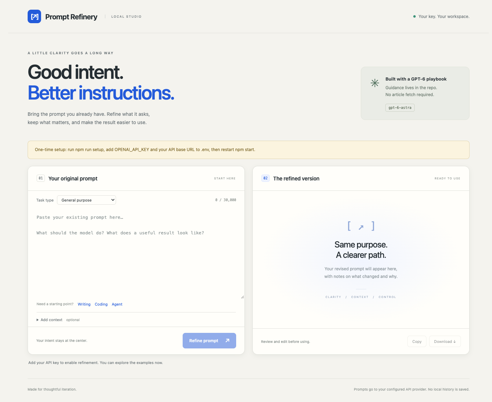

# Prompt Refinery

**Better instructions, same intent.** A local workspace that turns an existing prompt into a revised, ready-to-use prompt with change notes, assumptions, and suggested evaluation checks.

Paste a prompt, optionally add context, and click **Refine prompt**. The app combines your input with a versioned playbook stored in this repository and asks your configured model to edit it. It does not execute the task described by your prompt.



## Quick start

Requires **Node.js 22 or newer** and access to a model supporting the **Responses API with strict structured outputs**. There are no runtime dependencies and no frontend build step.

```bash
git clone https://github.com/monuminu/prompt-refinery.git
cd prompt-refinery
npm run setup
```

Edit the generated `.env`:

```dotenv
OPENAI_API_KEY=your-api-key
OPENAI_BASE_URL=https://api.openai.com/v1
OPENAI_MODEL=gpt-6-astra
```

Then start the workspace:

```bash
npm start
```

Open **http://127.0.0.1:3000**. Set `PORT` in `.env` if needed. Changes to `.env` require a restart. `npm run setup` preserves an existing `.env`; `.env.example` is the committed template and `.env` is ignored by Git. Environment variables take precedence over values in the file.

## What you get

- An editable revised prompt with copy and Markdown download controls.
- Notes explaining material edits and unresolved assumptions.
- Suggested checks for comparing the original and revised prompts on real inputs.
- General, writing, coding and agent workflow categories, plus examples.
- A browser UI and a CLI using the same optimizer.
- A bundled, readable playbook in [`knowledge/playbook.md`](knowledge/playbook.md), included in every request. The app does not fetch an article or depend on a documentation site at runtime.

The playbook is an original concise adaptation of selected GPT-6 prompting practices, reviewed on **2026-10-29**, rather than a complete copy of the source documentation. Provenance is recorded in [`NOTICE.md`](NOTICE.md). It focuses on prompt behavior; it is not a full model capability or API compatibility database.

## Configuration

| Variable | Default | Purpose |
| --- | --- | --- |
| `OPENAI_API_KEY` | empty | Your API key; required to request a revision. |
| `OPENAI_BASE_URL` | `https://api.openai.com/v1` | API root. The app appends `/responses`; include `/v1` or your provider's equivalent root. |
| `OPENAI_MODEL` | `gpt-6-astra` | Exact model identifier or deployment name available to your account. |
| `OPENAI_REASONING_EFFORT` | empty | Omits the parameter, using the provider default. Set only a value supported by your model. |
| `OPENAI_TIMEOUT_MS` | `120000` | Provider timeout, between 1,000 and 600,000 milliseconds. |
| `PORT` | `3000` | Local HTTP port, between 1 and 65,535. |

The default model follows the documentation checked on the date above. Model availability depends on your account. A custom base URL must accept bearer authentication, `POST /responses`, `store: false`, and the Responses API JSON-schema output format. Chat-Completions-only endpoints and Azure's older deployment-specific, `api-version` endpoints are not supported. An endpoint using an `/openai/v1` root can be configured if it supports the same contract.

Remote endpoints require HTTPS. HTTP is allowed for localhost development. Do not put keys in the base URL. Redirects are rejected so a provider cannot redirect the credential-bearing request elsewhere. No fallback model or silent switch to another endpoint is performed. Sampling parameters such as `temperature` are not sent.

## CLI

Save your existing prompt as `prompt.txt`, then run:

```bash
npm run optimize -- prompt.txt
npm run optimize -- prompt.txt coding context.txt
```

The optional arguments are a category (`general`, `writing`, `coding`, `agentic`) and a UTF-8 context file. The result is a JSON object with `optimizedPrompt`, `changes`, `assumptions`, and `checks`.

For JSON output suitable for a pipeline, call Node directly so npm's status lines are excluded:

```bash
node src/cli.mjs prompt.txt writing > revision.json
```

Errors go to stderr with a nonzero exit code. The CLI and web app load the `.env` next to `package.json`, regardless of the current working directory.

## Data flow and limits

The browser sends your original prompt, category and context to the local Node server. The server sends these inputs and the bundled playbook to **your configured API provider** using your key. API usage is billed by that provider. Output comes back to the browser as text; it is never executed or rendered as HTML.

The app does not write prompt history, use a database, include analytics, or save your API key in the browser. The browser holds the current input and result until you close or reload it; copy and download actions are explicit. The server sets `store: false` in provider requests, but provider retention and logging policies still apply. The footer's “no local history” refers to this app, not provider-side retention.

Input limits are 30,000 JavaScript string units for a prompt and 10,000 for context (emoji can count as two units), with a 256 KiB HTTP request cap. Results are limited to 16,000 output tokens, including model reasoning. An unfinished response is reported as an error rather than shown as a complete prompt. One revision runs at a time in the web app; it does not automatically retry paid requests.

This is a **local tool**, bound to `127.0.0.1`, without user accounts. Do not expose it through a public proxy or tunnel. A public GitHub repository does not publish or host the running app.

## Validation and tests

```bash
npm test
npm run check
```

Tests use a local fake Responses server and do not require a key. They exercise request serialization, embedded guidance, Unicode input, output parsing, refusals, truncation, timeouts, origin/host checks, static-file boundaries, secret-safe errors, configuration, CLI behavior and setup preservation. GitHub Actions runs the checks on Node 22 and 24.

These are deterministic integration checks, **not a live-model quality evaluation**. No live OpenAI request was made for the initial release. Prompt editing is probabilistic: inspect the output for changed meaning, lost placeholders, invented capabilities and unintended constraints. Compare both prompts on representative inputs before using a revision in production. The application cannot guarantee semantic preservation or higher task performance.

## Update the guidance

Edit `knowledge/playbook.md` and the editor instructions in `src/optimizer.mjs` as needed, update the review date and provenance, and rerun tests. Keep the adaptation concise and original. Changing the model in `.env` does not automatically replace the playbook with model-specific guidance. Evaluate a different model and any revised playbook on your own workload.

## License

MIT for this repository's original code and prose. See [`LICENSE`](LICENSE) and [`NOTICE.md`](NOTICE.md). This is an independent project and is not affiliated with OpenAI.
